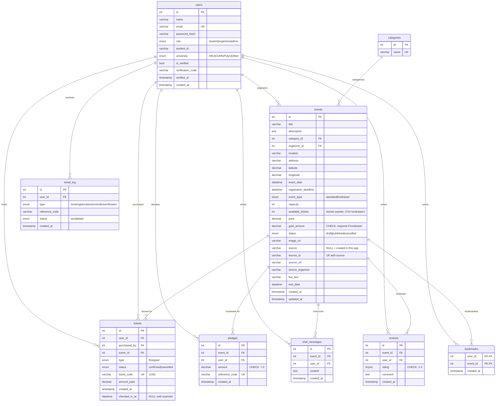

# Campus Hub — Database ER Diagram

Paste the block below into the [Mermaid Live Editor](https://mermaid.live) to view/export.

## Legend

- `PK` — primary key
- `FK` — foreign key
- `UK` — unique constraint
- `PK,FK` — composite primary key that is also a foreign key
- `CHECK` — MySQL 8 check constraint (enforced on insert/update)
- `rsvps` table is intentionally absent — replaced by `tickets` (free/paid ticketing with receipt reference codes)

## Notes for reviewers

- 9 tables total: `users`, `categories`, `events`, `tickets`, `pledges`, `chat_messages`, `reviews`, `email_log`, `bookmarks`
- All FKs use `ON UPDATE CASCADE`. `ON DELETE` is `RESTRICT` for `events.category_id`, `events.organizer_id`
  and all three FKs of `tickets` and both FKs of `pledges` (receipts must not disappear with a category,
  user or event — cancel events via `status` instead); every other FK uses `ON DELETE CASCADE`
- `tickets.user_id` is the attendee/holder; `tickets.purchased_by` is the student who paid, so one buyer
  can book seats for several registered students. `UNIQUE(user_id, event_id)` still applies per holder.
- `events.available_tickets` is the stored booking counter for standard events; booking decrements it
  and cancellation restores it inside the event-row lock. Fundraisers keep it at `0` (unlimited).
- All `DATETIME`/`TIMESTAMP` values are UTC (`event_date` is the start instant, not just a day)
- Fundraiser progress is computed live: `SELECT COALESCE(SUM(amount),0) FROM pledges WHERE event_id = ?`
- `pledges` has no `UNIQUE(user_id, event_id)` — repeat donations are allowed by design
- Chat time-window rules (open T-6h, close +7d) are enforced in Express middleware, not in SQL
- `events.source` marks scraped events (`NULL` = created in this app). They are owned by a system user,
  stay out of the default `GET /api/events` list (`?source=external` returns them) and are read-only in the API
